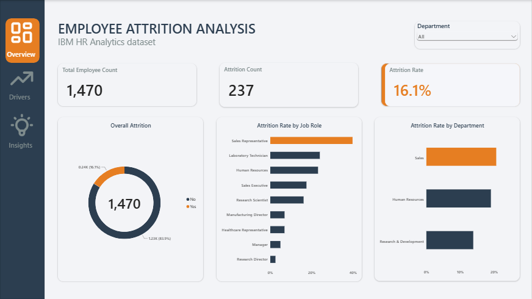
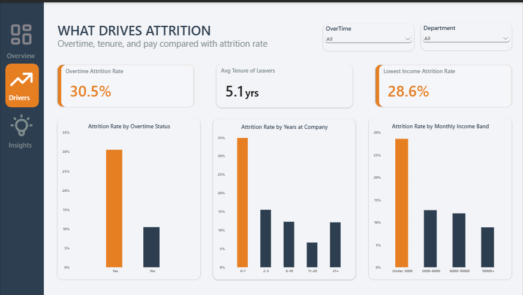
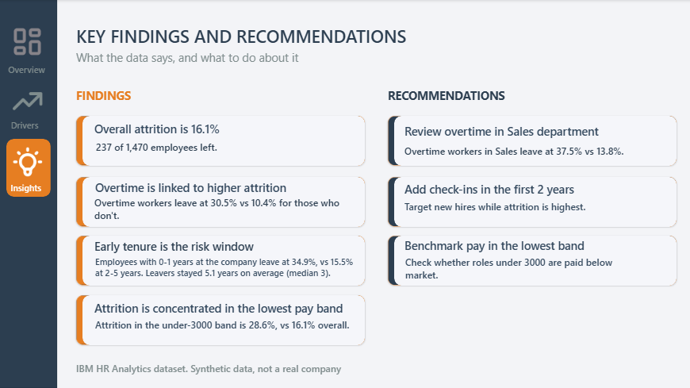

# Employee Attrition Analysis (Power BI)

A three-page Power BI dashboard that looks at who leaves a company and what is associated with them leaving, using the IBM HR Analytics Employee Attrition dataset.



## Business scenario

An HR team wants to understand why employees are leaving. Leadership needs to know how big the problem is, where it is concentrated, and which factors are linked to people quitting, so they can act before losing more staff.

**Role:** Junior Data Analyst

**Questions the dashboard answers**
1. What is the overall attrition rate, and how does it differ by department and job role?
2. Is working overtime linked to higher attrition?
3. Is there a point in an employee's tenure when they are most likely to leave?
4. Is pay linked to attrition?

## Dataset

[IBM HR Analytics Employee Attrition & Performance](https://www.kaggle.com/datasets/pavansubhasht/ibm-hr-analytics-attrition-dataset) (Kaggle). 1,470 employees and 35 columns, including department, job role, monthly income, overtime, years at company and an `Attrition` (Yes/No) field.

**This is a synthetic dataset created by IBM for teaching purposes. It does not describe a real company**, so the findings below illustrate an analysis approach and should not be read as real-world conclusions.

## Tools

- Power BI Desktop (Power Query for cleaning, DAX for measures and calculated columns)
- Excel (initial checks of row counts and the headline attrition figure)

## Data preparation

- Removed three columns that hold the same value in every row and cannot explain attrition: `EmployeeCount`, `StandardHours`, `Over18`.
- Added `AttritionFlag` (1 if the employee left, 0 if they stayed), so the average of the column is the attrition rate.
- Added readable label columns for the coded 1-4 fields (for example `JobSatisfaction`), each with a numeric sort-order column so charts show Low to Very High rather than alphabetical order. The original numeric columns were kept.
- Pay was measured with `MonthlyIncome`. `DailyRate`, `HourlyRate` and `MonthlyRate` were not used because their definitions are not documented.
- Grouped continuous fields into bands so charts stay readable:
  - `IncomeBand`: Under 3000, 3000-6000, 6000-10000, 10000+
  - `TenureBand`: 0-1, 2-5, 6-10, 11-20, 21+ years (`YearsAtCompany` is recorded in whole years)

### Key DAX

```dax
Total Employees = COUNTROWS(HR)

Attrition Count = SUM(HR[AttritionFlag])

Attrition Rate = DIVIDE([Attrition Count], [Total Employees])

Overtime Attrition Rate =
CALCULATE([Attrition Rate], HR[OverTime] = "Yes")

Avg Tenure of Leavers =
CALCULATE(AVERAGE(HR[YearsAtCompany]), HR[Attrition] = "Yes")

Lowest Income Attrition Rate =
CALCULATE([Attrition Rate], HR[IncomeBand] = "Under 3000")

IncomeBand =
SWITCH(TRUE(),
    HR[MonthlyIncome] < 3000, "Under 3000",
    HR[MonthlyIncome] < 6000, "3000-6000",
    HR[MonthlyIncome] < 10000, "6000-10000",
    "10000+")

TenureBand =
SWITCH(TRUE(),
    HR[YearsAtCompany] <= 1, "0-1",
    HR[YearsAtCompany] <= 5, "2-5",
    HR[YearsAtCompany] <= 10, "6-10",
    HR[YearsAtCompany] <= 20, "11-20",
    "21+")
```

## Dashboard pages

**1. Overview.** Total employees, attrition count and attrition rate, the overall split, and attrition rate by job role and by department. A department slicer filters the page.


**2. Drivers.** Attrition rate by overtime status, by tenure band and by income band, each paired with a headline KPI. Slicers for overtime and department.



**3. Key findings and recommendations.** A plain-language summary of what the data shows and what to do about it.



## Key findings

1. **Overall attrition is 16.1%.** 237 of 1,470 employees left.
2. **Overtime is linked to higher attrition.** Employees working overtime left at 30.5% (127 of 416), against 10.4% (110 of 1,054) for those who did not. The gap appears in every department.
3. **Early tenure is the risk window.** Employees with 0-1 years at the company left at 34.9% (75 of 215), against 15.5% at 2-5 years and 12.3% or lower in the bands after that. Leavers stayed 5.1 years on average, but the median is 3 years, because a few long-serving leavers pull the average up.
4. **Attrition is concentrated in the lowest pay band.** The under-3000 band left at 28.6% (113 of 395), against 16.1% overall. The 3000-6000 and 6000-10000 bands were below average (12.7% and 12.0%).
5. **Sales stands out.** Sales has the highest department attrition (20.6%), and Sales Representative is the highest-attrition role (39.8%, 33 of 83). Within Sales, employees on overtime left at 37.5% against 13.8% for those who did not.

## Recommendations

1. **Review overtime in Sales.** Overtime workers in Sales leave at 37.5% against 13.8%.
2. **Add check-ins in the first two years.** Attrition is highest at 0-1 years (34.9%).
3. **Benchmark pay in the lowest band.** About 27% of employees (395) earn under 3000 and leave at 28.6%. Check whether those roles are paid below market.

## Limitations

- **Synthetic data.** The dataset is not from a real company, so findings are illustrative.
- **Association, not causation.** Overtime, low pay and short tenure overlap. For example, employees under 3000 who work overtime left at 56.1% (64 of 114), against 17.4% for those who do not. The analysis does not separate the effects of each factor.
- **Small groups.** Some groups are small, so their percentages swing easily. Sales Representative has 83 people and the 21+ years band has 66.
- **Banding choices.** Income and tenure bands were chosen for readability. Different cut points could change how sharp the patterns look.
- **No time dimension.** The dataset is a single snapshot, so it cannot show how attrition changed over time.

## Repo structure

```
README.md
dashboard/    Power BI file (.pbix)
images/       dashboard screenshots used above
```
## Download the Power BI Dashboard

The interactive Power BI dashboard is available in the GitHub Releases section.

[Check the Employee Attrition Dashboard (.pbix)](https://app.powerbi.com/groups/me/reports/47e09396-a7c7-4711-8aa5-c8656c64c06d/52c83f9c19a84dea081e?experience=power-bi&bookmarkGuid=7b0d839da0a9953b6b09)

**[Download the Employee Attrition Dashboard (.pbix)](https://github.com/Dasha69-ops/hr-employee-attrition-analysis/releases/download/v1.0.0/HR_EMPLOYEE_ATTRITTION)**

To explore the dashboard, download the `.pbix` file and open it using Power BI Desktop. The source dataset is available through the Kaggle link provided above.
